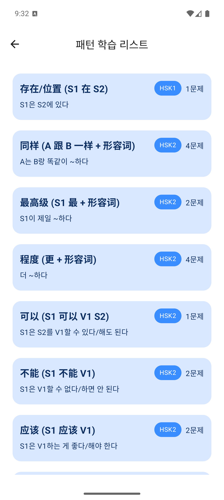
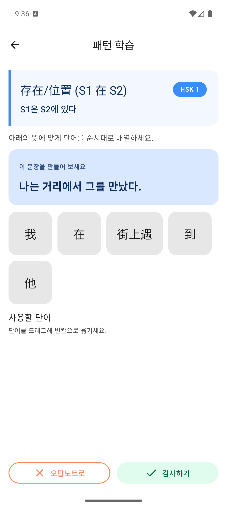
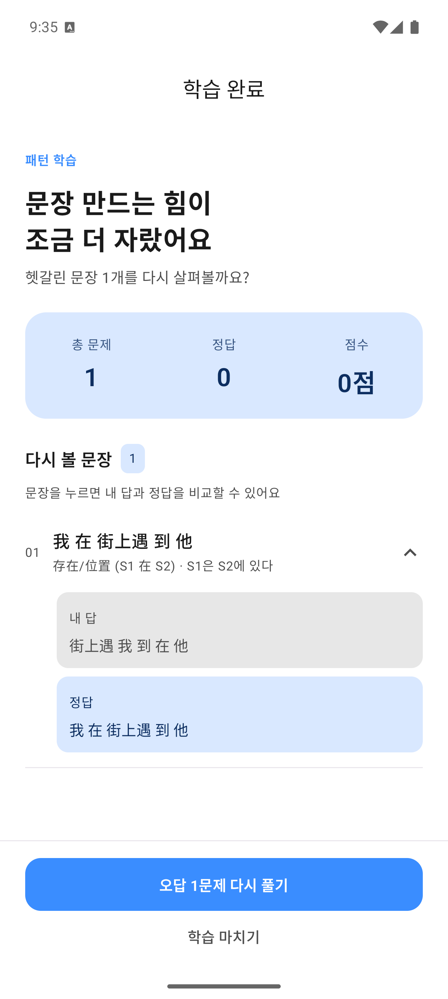
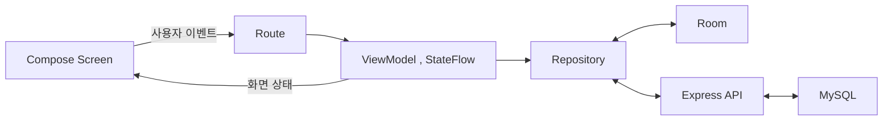

# 롱이, 쉬운중국어

**롱이(容易, Rongyi)**는 HSK 단어와 문장 패턴을 학습하는 Android 앱입니다. 한국어 뜻을 보고 중국어 문장 조각을 배열하고, 다시 볼 단어와 문제를 골라 복습합니다.

중국어를 공부하면서 HSK 쓰기 영역의 문장 배열 문제가 특히 어려웠습니다. 제가 접한 앱에서는 단어장 외의 학습 콘텐츠가 유료인 경우가 많았고, 이 연습을 무료로 반복할 수 있는 앱을 직접 만들어 쓰고 싶었습니다.

**기획부터 Android 앱, API 서버와 DB, 학습 데이터 구성, Google Play 배포까지 직접 진행하는 개인 프로젝트입니다.** 편리하고 직관적인 학습 흐름을 만드는 데 집중하고 있습니다.

[Google Play](https://play.google.com/store/apps/details?id=com.towb.appeasychinese&hl=ko) | [전체 화면](assets/SCREENSHOTS.md) | [개발 이야기](docs/01-building-rongyi.md) | [구현 상세](docs/03-implementation.md)

## 뜻을 보고 문장을 만드는 연습

패턴의 형태와 의미를 확인하고, 한국어 문장에 맞게 중국어 조각을 드래그해 순서대로 놓습니다. 배열을 검사한 뒤 다시 시도하거나, 오답노트에 담아 복습할 수 있습니다.

| 패턴 선택 | 문장 배열 | 답안 비교 |
|---|---|---|
|  |  |  |

화면은 `0.0.8(104)`를 실행해 촬영했습니다. 홈,단어 카드,복습,설정과 라이트,다크 모드는 [화면 문서](assets/SCREENSHOTS.md)에서 확인할 수 있습니다.

## 함께 제공하는 학습 기능

- **HSK 단어 카드:** 레벨과 챕터별 단어를 익히고, 예문 속 쓰임을 확인합니다. 학습 중인 단어는 예문에서도 강조합니다.
- **선택한 항목 복습:** 단어는 `다시 볼래요`, 패턴은 `오답노트로`를 통해 복습할 대상을 고릅니다.
- **일일 학습 목표:** 하루 목표와 학습 완료 기록, 연속 학습 일수를 확인합니다.
- **저장된 콘텐츠 활용:** 기기에 불러온 단어,패턴을 저장하고, 네트워크가 불안정할 때도 활용하도록 구성했습니다.

## 직접 설계하고 구현한 범위

| 영역 | 맡은 작업 |
|---|---|
| 서비스,화면 | 학습 흐름 기획, Compose UI, 단어,패턴,완료,복습 화면 |
| 학습 데이터 | 단어,패턴,예문 관계, 문장 조각과 기준 순서 구성 |
| Android 로직 | 상태 관리, 채점 연결, 진행 저장, 콘텐츠 캐시, 일일 학습 기록 |
| 서버,DB | 학습 콘텐츠 조회와 배열 채점 API, DB 구조, 앱 상태,오류 처리 |
| 배포,개선 | Google Play 배포, 환경 분리, 화면 개선과 동작 보완 |

가장 오래 고민한 것은 **예문을 배열 문제로 바꾸는 데이터 구조**였습니다. 문장을 어떤 조각으로 나누고, 사용자가 만든 순서를 어떻게 채점,기록하며, 복습에서 다시 보여줄지 앱과 서버를 함께 설계했습니다.

[문장 배열 학습을 만들며 고민한 과정](docs/01-building-rongyi.md)

## 구현에서 중요하게 다룬 것

### 문장 각의 순서를 채점부터 복습까지 연결하기

문장 조각 ID와 배열 순서를 답안으로 다룹니다. 제출 순서와 기준 순서를 기록해 완료 화면에서 비교하고, 선택한 문제로 복습 라운드를 구성합니다.

### 연결 실패와 데이터 갱신을 함께 고려하기

Room에 콘텐츠와 학습 진행을 구분해 저장합니다. 서버의 `WORD`,`PATTERN` 버전으로 캐시 최신성을 비교하고, 파싱할 수 없는 캐시는 해당 행만 조건부로 제거합니다. 네트워크 연결 실패에서는 문제의 기준 순서로 로컬 채점합니다.

### 반복 입력에도 학습 상태 지키기

채점 중 중복 제출과 정답 재집계를 막고, 현재 화면,문제 상태를 확인해 오래된 입력에 따른 중복 진행을 제한합니다. 완료 결과는 화면 이동 후에도 보관하도록 구성했습니다.

[학습 흐름,채점,캐시,상태 관리 상세](docs/03-implementation.md)

## 기술 구성

| 구분 | 기술 |
|---|---|
| Android UI | Kotlin, Jetpack Compose, Material 3 |
| 상태,비동기 | ViewModel, StateFlow, Coroutines |
| 통신,저장 | Retrofit, OkHttp, Gson, Room, SharedPreferences |
| 의존성 주입 | Hilt |
| API,DB | Node.js, Express, MySQL |

## 현재와 다음 단계

Google Play에 배포한 앱을 바탕으로 **v0.0.8을 배포 중**입니다. 최근에는 단어 강조, 완료 화면과 오답 비교, 패턴 문제의 가독성, 캐시 복구와 중복 이동 처리를 개선했습니다.

Dev Kotlin 컴파일과 기존 단위 테스트 16개가 통과했고, 에뮬레이터에서 단어 학습 완료,복습 진입과 패턴 오답 제출,답안 비교,복습 후 정답 완료를 확인했습니다. 자세한 확인 범위는 [검증 기록](docs/04-verification.md)에 정리했습니다.

다음 목표는 학습 데이터와 콘텐츠를 보강하는 것입니다. 이후에는 답안 설명과 복습을 돕는 **학습 매니저**를 유료 기능 후보로 검토하고 있습니다. 별도의 연구 목표로는 작은 언어 모델을 처음부터 학습하며 데이터 준비,학습,평가 과정을 공개하고 싶습니다. 이미지,동영상을 활용한 학습과 듣기 연습도 장기적으로 탐색하려 합니다.

앞으로는 학습 콘텐츠를 확충하고, 답안 설명과 복습을 돕는 기능으로 확장할 계획입니다.

## 더 읽기

| 문서 | 내용 |
|---|---|
| [개발 이야기](docs/01-building-rongyi.md) | 직접 필요했던 연습을 앱,서버,데이터로 연결한 과정 |
| [전체 화면](assets/SCREENSHOTS.md) | 최신 라이트,다크 화면과 이전 버전 기록 |
| [현재 구현](docs/03-implementation.md) | 채점,복습,캐시,상태 처리 방식 |
| [검증 기록](docs/04-verification.md) | 코드 기준, 실행 확인과 남은 검증 |

이 저장소는 서비스 소개와 개발 기록을 공개하는 포트폴리오입니다. 앱, 서버 전체 소스는 비공개로 관리하며, 인증, 배포 정보와 개인 데이터는 공개 자료에서 제외합니다.
