# 롱이 화면 둘러보기

홈에서 학습을 시작하고, 단어,문장 배열을 연습한 뒤 복습으로 이어지는 화면을 모았습니다. 대표 이미지는 라이트 모드이며, 주요 화면의 다크 모드도 함께 볼 수 있습니다.

[홈과 목표](#home) | [단어 학습](#words) | [패턴 학습](#patterns) | [설정](#settings) | [다크 모드](#themes)

## 홈과 일일 학습 목표

| 홈 | 일일 목표 변경 |
| --- | --- |
| 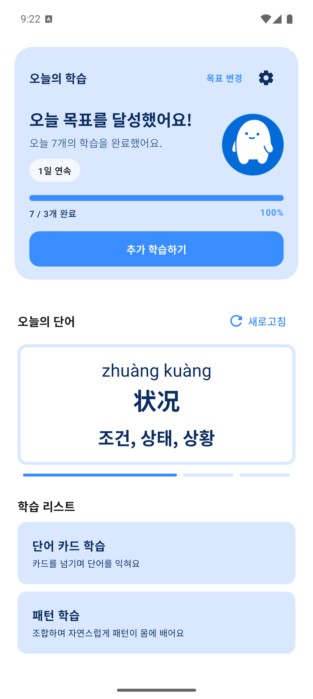 | 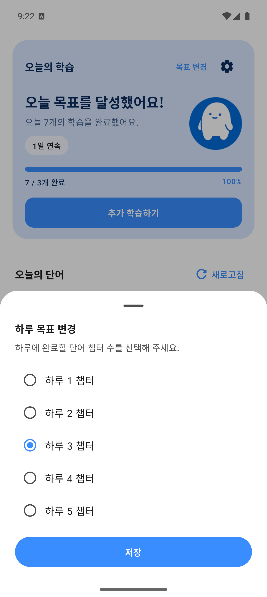 |

오늘의 학습량과 연속 학습 일수, 목표 달성률을 확인하고 단어,패턴 학습을 시작합니다. 목표 변경은 바텀 시트에서 처리합니다. 홈의 숫자는 촬영용 에뮬레이터의 로컬 학습 기록입니다.

## HSK 단어 학습

| 레벨,챕터 선택 | 단어 카드와 예문 |
| --- | --- |
| 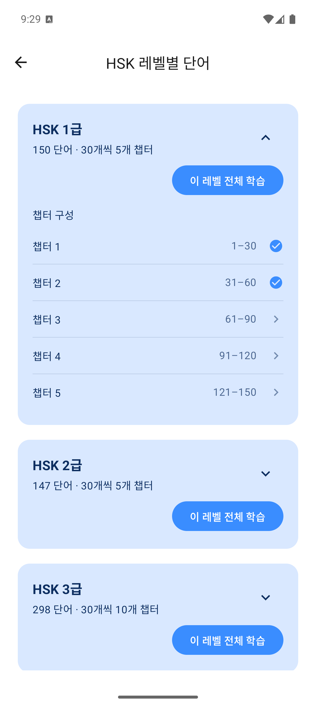 | 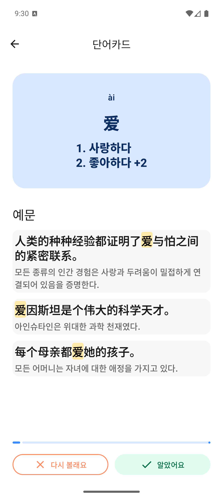 |

HSK 레벨과 챕터를 골라 단어를 학습합니다. 카드를 누르면 뜻과 예문 번역이 나타나며, 예문 속 학습 단어는 파스텔 노란색으로 강조합니다.

| 학습 완료 | 선택한 단어 복습 |
| --- | --- |
| 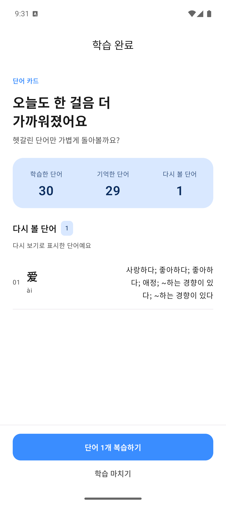 | 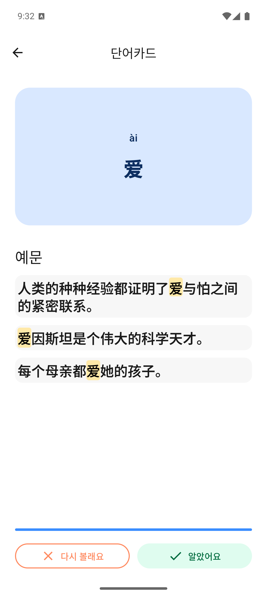 |

`다시 볼래요`로 표시한 단어를 완료 화면에 모아 보여주고, 복습하기를 누르면 해당 단어만 다시 학습합니다. 단어 학습은 별도 객관식 채점 대신 사용자의 다시 보기 선택을 기준으로 기록합니다.

## 문장 패턴 학습

| 패턴 선택 | 문제 시작 |
| --- | --- |
|  | 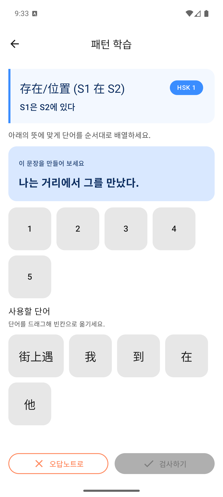 |

학습할 패턴과 뜻을 확인한 뒤 한국어 문제 문장에 맞게 중국어 조각을 드래그합니다. 패턴 이름과 한국어 문제는 역할에 따라 강조 방식을 구분했습니다.

| 문장 배열 | 오답 제출 |
| --- | --- |
|  | 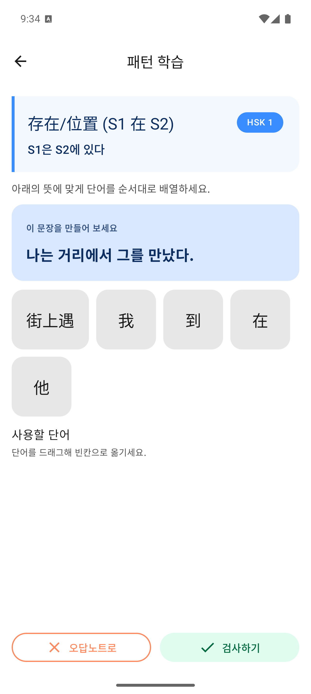 |

서버 채점을 우선 사용하며 네트워크 연결 실패에서는 문제의 기준 순서로 로컬 채점합니다. 일반 API 오류를 로컬 채점으로 덮어쓰지는 않습니다. 오답이면 조각을 다시 배열하거나 `오답노트로`를 선택할 수 있습니다.

| 오답이 있는 완료 | 모두 정답인 완료 |
| --- | --- |
|  | 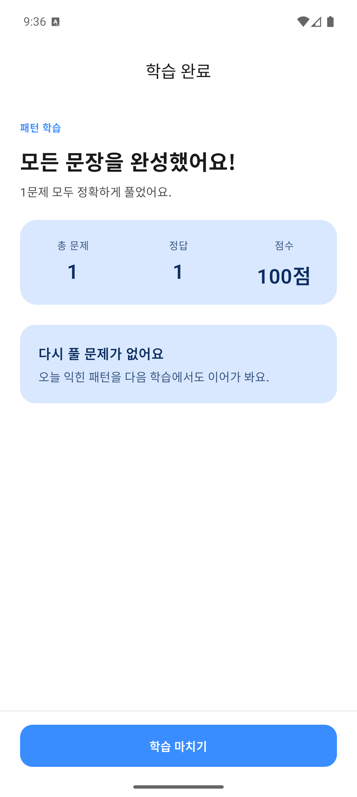 |

오답노트는 사용자가 선택한 문제를 복습 대상으로 모읍니다. 완료 화면에서는 내 답과 기준 답을 펼쳐 비교하며, 복습 버튼으로 해당 문제를 다시 풉니다. 모두 정답이면 복습 버튼 없이 마칩니다.

라이트 모드 오답 완료 화면은 실제 오답을 제출한 사례이며, 모두 정답 화면은 같은 문제를 복습에서 맞힌 후 촬영했습니다. 다크 모드 오답 화면은 답 제출 없이 오답노트로 보낸 사례이므로 내 답에 `-`가 표시됩니다.

## 설정과 저장 공간

| 설정 | 삭제 범위 선택 |
| --- | --- |
| 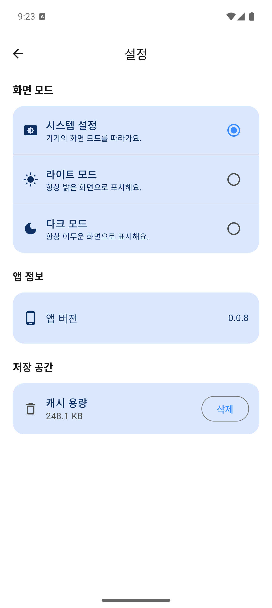 | 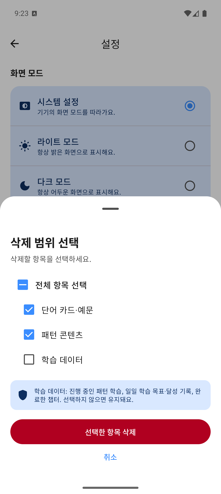 |

System,Light,Dark 모드를 선택할 수 있습니다. 캐시는 단어,예문과 패턴 콘텐츠를 구분하고, 학습 기록은 별도의 선택 항목으로 표시합니다. 삭제 시트는 선택 화면만 촬영했으며 데이터를 삭제하지 않았습니다.

## 라이트,다크 모드 비교

주요 6개 화면의 라이트,다크 비교 펼치기

### 홈

| 라이트 | 다크 |
| --- | --- |
|  | 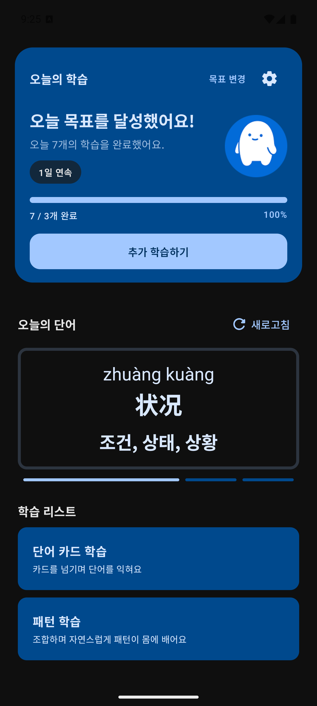 |

### 단어 카드

| 라이트 | 다크 |
| --- | --- |
|  | 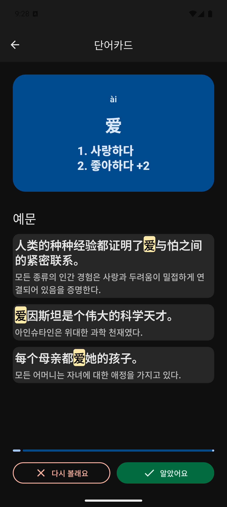 |

### 패턴 목록

| 라이트 | 다크 |
| --- | --- |
|  | 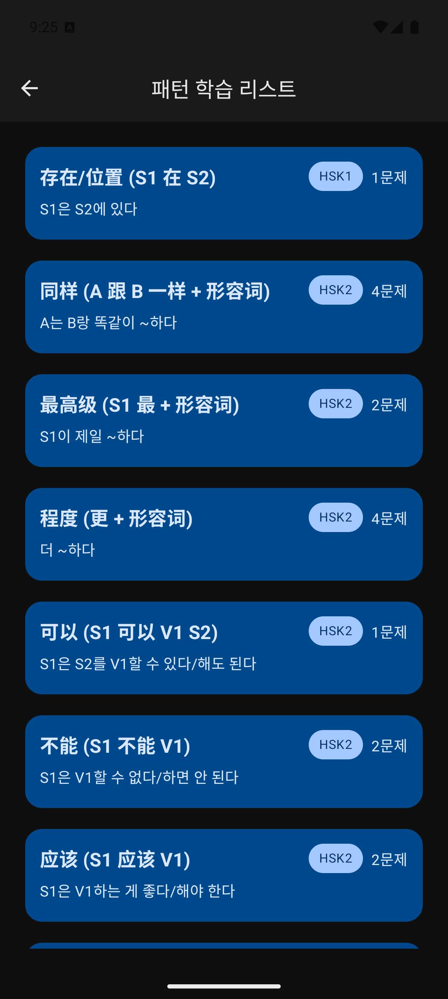 |

### 패턴 문제

| 라이트 | 다크 |
| --- | --- |
|  | 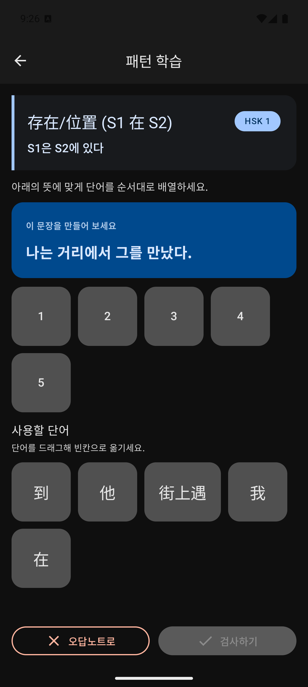 |

### 오답 상세

| 라이트 | 다크 |
| --- | --- |
|  | 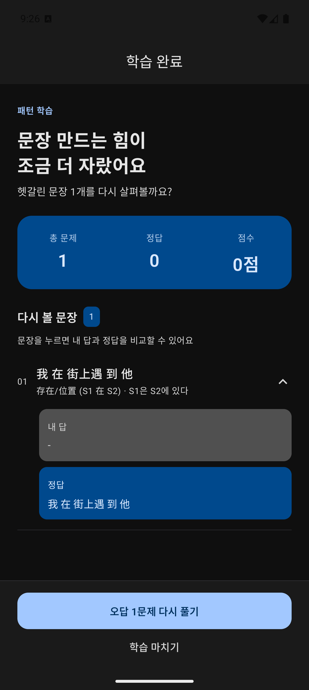 |

### 설정

| 라이트 | 다크 |
| --- | --- |
|  | 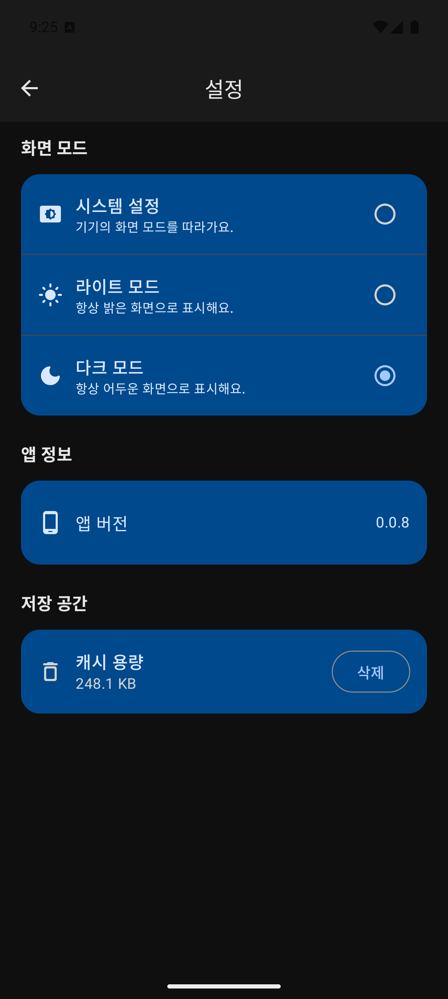 |

## 촬영 기준

2026-10-28에 `0.0.8(104)`를 Android 에뮬레이터에서 실행해 촬영했습니다. 최신 화면은 라이트 14장,다크 6장이며, 캡처 조건과 확인한 학습 흐름은 [검증 기록](../docs/04-verification.md)에 정리했습니다.

[서비스 소개](../README.md) | [현재 구현](../docs/03-implementation.md) | [검증 기록](../docs/04-verification.md)
