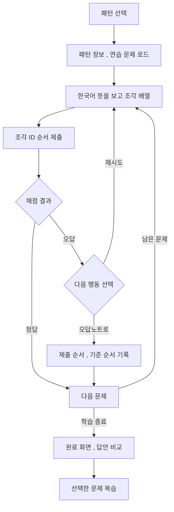

# 현재 구현으로 보는 롱이의 학습 구조

기준: Android 앱 `develop`, 2026-10-28 확인. 실행 결과와 캡처 조건은 [검증 기록](04-verification.md)에 정리했습니다.

## 학습 한 번을 끝까지 연결하기

롱이의 중심은 한국어 뜻을 보고 중국어 문장을 조각으로 배열하는 경험입니다. 이 기능을 위해 화면 조작, 조각의 식별과 정답 순서, 채점, 진행 상태, 복습 대상을 연결했습니다.

오답을 제출한 모든 문제를 곧바로 오답노트에 넣지는 않습니다. 사용자가 `오답노트로`를 선택할 때 복습 대상에 포함합니다. 이 버튼은 아직 채점하지 않은 문제에서도 사용할 수 있습니다.

## 조각 식별자와 순서로 답안을 표현하기

패턴 연습 데이터에는 예문과 문장 조각, 기준 순서가 포함됩니다. 앱은 사용자가 놓은 조각의 식별자 순서를 답안으로 제출합니다. 채점이 성공하면 서버에서 받은 정답 여부와 제출,기준 순서를 화면 상태에 반영합니다.

조각 순서를 보관하므로, 완료 화면에서 사용자가 만든 배열을 다시 구성할 수 있습니다. 복습 결과의 `WrongItemSummary`에는 패턴 이름과 의미, 내 답, 정답을 읽을 수 있는 문자열로 전달합니다.

현재 방식은 등록된 기준 배열과의 일치를 검사합니다. 다른 어순도 문법적으로 가능한지는 별도의 언어 검수가 필요한 문제입니다. 앞으로 해설을 추가하더라도 기존 배열 비교와 생성된 설명의 역할을 구분할 계획입니다.

## 네트워크 상태에 따라 채점 경로 구분하기

`PatternViewModel.gradeCurrentQuestion`은 서버 채점을 우선 사용합니다.

| 결과 | 앱 동작 |
|---|---|
| 서버 채점 성공 | 응답의 정답 여부와 배열을 반영 |
| 네트워크 `IOException` | 문제에 들어 있는 기준 순서로 로컬 채점 |
| 그 밖의 API 오류 | 오류를 표시하고 로컬 판정으로 대체하지 않음 |

채점 중이거나 이미 정답 처리한 문제는 다시 제출하지 않도록 막습니다. 다음 문제,오답노트 이벤트도 현재 표시된 문제의 인덱스와 최신 상태를 비교해 같은 화면의 오래된 입력이 연속 진행으로 이어지지 않게 합니다.

로컬 채점은 저장된 문제를 계속 연습하는 데 사용합니다. 결과는 앱의 학습 상태에 반영하며, 서버 계정 기록으로의 동기화는 현재 범위에 포함하지 않습니다.

## 콘텐츠와 학습 진행을 각각 저장하기

Room에서 학습 콘텐츠 캐시와 패턴 진행 상태를 구분합니다. 설정 화면에서도 단어, 예문, 패턴 콘텐츠, 학습 데이터를 선택해 삭제할 수 있습니다.

| 데이터 | 처리 방식 |
|---|---|
| HSK, 단어 페이지, 패턴 목록과 상세 | 저장된 콘텐츠를 먼저 활용 |
| 단어 페이지 캐시 | 최대 12개 유지 |
| 패턴 콘텐츠 | 현재 개수 상한 없이 저장 |
| 패턴 진행 상태 | 현재 문제와 복습 관련 상태를 별도 저장,복원 |
| 일일 학습 | 날짜별 목표와 완료 수, 챕터 완료 이력 관리 |

단어 관련 콘텐츠는 `WORD`, 패턴 콘텐츠는 `PATTERN` 버전으로 최신성을 비교합니다. 서버 버전과 캐시 버전이 같으면 콘텐츠 재요청을 생략하는 흐름을 사용합니다. 상태 API를 읽지 못했더라도 이후 콘텐츠 응답의 유효한 버전을 메모리에 반영하며, 개별 콘텐츠 응답의 더 낮은 버전은 기존 값을 덮어쓰지 않습니다.

캐시 JSON을 파싱하지 못하거나 결과가 `null`이면 해당 행을 제거합니다. 이때 읽은 payload와 현재 행이 같을 때만 지워, 그 사이 새 응답으로 갱신된 캐시를 삭제하지 않도록 했습니다. JSON 문법은 정상이지만 필수 필드가 누락된 모든 경우까지 검증하는 구조는 아닙니다.

## 완료 화면의 데이터와 이동을 함께 다루기

단어 완료 이벤트는 화면을 그리는 코드에서 직접 이동시키는 대신 `LaunchedEffect`에서 처리합니다. 이동 요청은 해당 학습 화면이 현재 화면일 때만 허용하고, 완료 화면에 대해서는 `launchSingleTop`을 사용합니다.

완료 결과는 목적지의 `SavedStateHandle`에도 보관합니다. 이전 화면의 데이터를 읽자마자 삭제하던 흐름을 바꿔 재구성,상태 복원에 사용할 결과가 남도록 했습니다. 완료 화면의 복습,종료 이벤트도 현재 화면인지 확인합니다.

단어 완료 화면은 한자,병음,뜻을 표시하고, 패턴 완료 화면은 내 답,정답 비교를 펼쳐 보여줍니다. 처음에는 오답 세 개만 표시하며 전체 보기를 통해 확장할 수 있습니다. 오답이 없으면 복습 버튼을 두지 않습니다.

## 목록과 일일 학습의 일관성

패턴 목록은 최초 로딩과 추가 페이지 로딩을 구분합니다. 추가 로딩 실패가 기존 목록을 빈 화면으로 바꾸지 않도록 처리하고, 상세에서 돌아온 사용자의 스크롤 위치도 복원합니다.

`develop`의 일일 학습 구현은 챕터 완료 이력 삽입과 날짜별 완료 수 갱신을 하나의 Room 트랜잭션으로 처리합니다. 중복 완료 이력의 삽입 결과를 확인해 같은 챕터가 반복 집계되지 않도록 구성합니다. 목표를 달성한 날짜를 기준으로 연속 학습 일수를 계산합니다.

## 앱 실행과 요청 실패도 학습 흐름의 일부로

앱 실행 시 시스템 점검, 강제 업데이트, 선택 업데이트, 정상 진입을 구분합니다. 상태 API 자체의 실패가 저장된 학습 콘텐츠까지 막지 않도록 정상 진입하는 경로를 둡니다.

## 구현 범위와 다음 확인

현재 채점은 기준 배열과의 일치를 판단합니다. 캐시 복구는 파싱 실패와 JSON `null`을 다루며, 패턴 진행 세션의 버전 호환성과 필수 필드 검증은 추가 설계 대상입니다.

구현과 실행 확인을 구분해 [검증 기록](04-verification.md)에 남겼습니다. 연속 입력,상태 복원,네트워크 전환은 별도의 회귀 확인으로 관리합니다.

[서비스 소개](../README.md) | [개발 이야기](01-building-rongyi.md) | [전체 화면](../assets/SCREENSHOTS.md)
